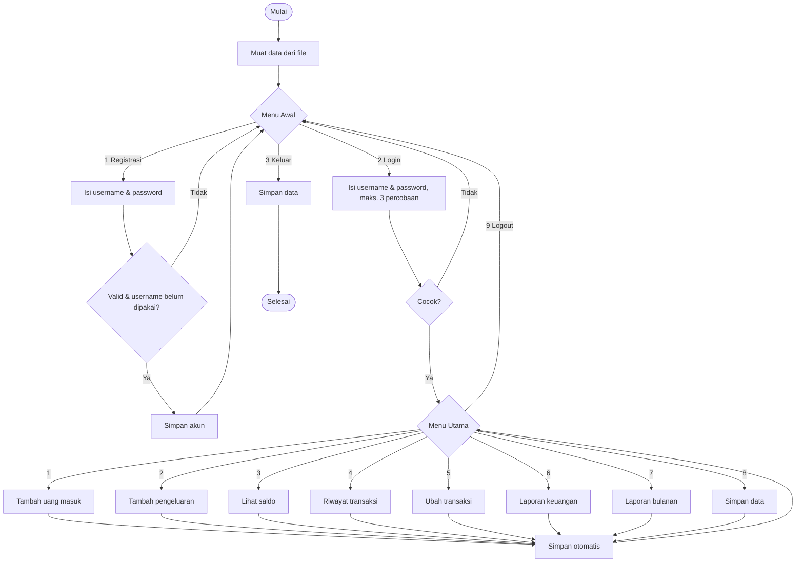

# Sistem Keuangan Mahasiswa (Console)

**LAPORAN TUGAS PEMROGRAMAN BAHASA C | KELOMPOK 1**

| No | Nama Anggota | NIM |
|----|--------------|-----|
| 1 | Muhammad Fahri Halim | 26071101273 |
| 2 | Ainayya Fadillah Diya'i | 26071101770 |
| 3 | Raka Adi Pratama | 26071206558 |
| 4 | Agung Rahman | 26071102218 |

---

## 1. Pendahuluan

### 1.1 Latar Belakang
Mahasiswa umumnya mengelola uang saku bulanan yang terbatas. Tanpa pencatatan, pengeluaran kecil yang berulang sulit dikontrol dan saldo sering baru disadari menipis di akhir bulan. Aplikasi ini dibuat sebagai alat pencatat keuangan sederhana berbasis *console* yang ditulis dalam bahasa C.

### 1.2 Tujuan
1. Membantu mahasiswa mengelola keuangan pribadi.
2. Mempermudah pencatatan pemasukan dan pengeluaran.
3. Menampilkan kondisi saldo secara teratur.
4. Menerapkan konsep dasar pemrograman bahasa C (struct, array, pointer, fungsi, modularisasi, file I/O).

### 1.3 Fitur Aplikasi
1. Registrasi Pengguna dan Login
2. Tambah Uang Masuk
3. Tambah Pengeluaran
4. Lihat Saldo
5. Riwayat Transaksi
6. Laporan Keuangan
7. Ubah Data Transaksi
8. Simpan Data
9. Keluar Aplikasi
    

---

## 2. Fitur Aplikasi

| No | Fitur | Keterangan |
|----|-------|------------|
| 1 | Registrasi & Login | Username 3-29 karakter, password 4-29 karakter, tanpa spasi. Login diberi 3 kali percobaan. |
| 2 | Tambah uang masuk | Mencatat pemasukan (jumlah, kategori, keterangan, tanggal). |
| 3 | Tambah pengeluaran | Mencatat pengeluaran; muncul peringatan jika melebihi saldo. |
| 4 | Lihat saldo | Menampilkan saldo = total masuk - total keluar. |
| 5 | Riwayat transaksi | Daftar seluruh transaksi milik pengguna beserta total dan saldo. |
| 6 | Ubah transaksi | Mengubah jumlah, kategori, keterangan, atau tanggal berdasarkan ID. |
| 7 | Laporan keuangan | Ringkasan total + persentase pengeluaran per kategori. |
| 8 | Laporan bulanan | Rekap masuk, keluar, dan selisih per bulan. |
| 9 | Simpan data | Manual lewat menu, dan otomatis setiap selesai satu aksi. |
| 10 | Logout / Keluar | Kembali ke menu awal atau menutup aplikasi. |

> Fitur **Cari Transaksi** dan **Hapus Transaksi** sudah dihapus dari aplikasi (menu, kode, dan header).

---

## 3. Struktur Folder dan Pembagian Modul

```
Sistem-Keuangan-Mahasiswa-Console/
├── include/
│   ├── file.h          # simpan & muat data
│   ├── laporan.h       # saldo & laporan
│   ├── menu.h          # menu & titik masuk aplikasi
│   ├── transaksi.h     # struct Transaksi & fungsi transaksi
│   └── user.h          # struct User & fungsi akun
├── src/
│   ├── main(fahri).c
│   ├── menu(fahri).c
│   ├── user(agung).c
│   ├── transaksi(ainayya).c
│   ├── laporan(raka).c
│   └── file(raka).c
├── data_user.txt       # data akun (dibuat/diperbarui otomatis)
├── data_transaksi.txt  # data transaksi (dibuat/diperbarui otomatis)
└── README.md
```

| Modul | Berkas (berdasarkan penamaan berkas) | Tanggung jawab |
|-------|--------------------------------------|----------------|
| Menu & utama | `main(fahri).c`, `menu(fahri).c` | Alur menu awal & menu utama, membaca pilihan dengan aman |
| Pengguna | `user(agung).c` | Registrasi, login, logout, validasi username/password |
| Transaksi | `transaksi(ainayya).c` | Tambah, riwayat, ubah; validasi jumlah & tanggal |
| Laporan | `laporan(raka).c` | Hitung saldo, laporan keuangan, laporan bulanan |
| Penyimpanan | `file(raka).c` | Simpan & muat data dari berkas teks |

---

## 4. Struktur Data dan Format Penyimpanan

```c
typedef struct {            /* user.h */
    char username[30];
    char password[30];
} User;

typedef struct {            /* transaksi.h */
    int  id;
    char username[30];      /* pemilik transaksi */
    int  tipe;              /* 0 = masuk, 1 = keluar */
    long jumlah;            /* rupiah */
    char kategori[30];
    char keterangan[60];
    char tanggal[11];       /* DD-MM-YYYY */
} Transaksi;
```

Data disimpan dalam berkas teks:

- `data_user.txt` : satu baris per akun, `username password`
- `data_transaksi.txt` : satu baris per transaksi, dipisah tanda `|`

```
1|user1|0|50000|Gaji|bulanan|23-11-2026
2|user1|1|15000|Makan|siang|23-11-2026
```

Penyimpanan ditulis ke berkas sementara (`.tmp`) terlebih dahulu, lalu menggantikan berkas lama, sehingga berkas lama tidak rusak jika penyimpanan gagal. Baris yang rusak dilewati saat data dimuat dan dilaporkan sebagai peringatan.

---

## 5. Alur Proses

### 5.1 Alur Umum Aplikasi



### 5.2 Alur Tambah Uang Masuk / Pengeluaran

```mermaid
flowchart TD
    A([Pilih menu 1 atau 2]) --> B{Data penuh?}
    B -->|Ya| X([Batal: data penuh])
    B -->|Tidak| C[Input jumlah]
    C --> C1{Jumlah valid?}
    C1 -->|Tidak, ulang maks. 3x| C
    C1 -->|Ya| D[Input kategori & keterangan]
    D --> E[Input tanggal]
    E --> E1{Tanggal valid?}
    E1 -->|Tidak, ulang maks. 3x| E
    E1 -->|Ya| F{Pengeluaran melebihi saldo?}
    F -->|Ya| F1[Tampilkan peringatan] --> G
    F -->|Tidak| G[Buat ID baru & simpan ke array transaksi]
    G --> H[Tampilkan saldo sekarang]
    H --> I([Kembali ke menu utama])


Jika jumlah atau tanggal tetap salah setelah 3 percobaan, transaksi dibatalkan dengan pesan *"Saldo tidak berubah"*.

### 5.3 Alur Lihat Saldo

   mermaid
flowchart LR
    A([Pilih menu 3]) --> B[Ambil username aktif]
    B --> C[Jumlahkan transaksi bertipe MASUK milik user]
    B --> D[Jumlahkan transaksi bertipe KELUAR milik user]
    C --> E[Saldo = total masuk - total keluar]
    D --> E
    E --> F([Tampilkan saldo])
```

### 5.4 Alur Penyimpanan dan Pemuatan Data

   mermaid
flowchart TD
    subgraph Simpan
    S1[Tulis user & transaksi ke file .tmp] --> S2{Berhasil?}
    S2 -->|Ya| S3[Ganti file lama dengan file .tmp]
    S2 -->|Tidak| S4[Tampilkan pesan gagal, file lama tetap utuh]
    end
    subgraph Muat
    M1[Buka file user & transaksi] --> M2[Baca baris demi baris]
    M2 --> M3{Baris valid?}
    M3 -->|Ya| M4[Masukkan ke array]
    M3 -->|Tidak| M5[Lewati & hitung sebagai peringatan]
    end


## 6. Perbaikan: Saldo Tetap Nol

**Gejala:** setelah memasukkan nilai, menu *Lihat Saldo* menampilkan `Rp 0`, dan `data_transaksi.txt` tetap kosong.

**Hasil analisis:** rumus saldo (`hitungSaldo` = total masuk - total keluar) sudah benar. Saldo bernilai nol karena transaksi **tidak pernah tercatat**: validasi input terlalu kaku dan langsung menggagalkan seluruh proses. Pada versi sebelumnya:

- Jumlah seperti `50.000`, `50,000`, atau `Rp 50000` ditolak (hanya angka polos yang diterima).
- Tanggal selain format persis `DD-MM-YYYY` (misalnya `23/11/2026` atau `5-1-2026`) ditolak.
- Setelah ditolak, fungsi langsung kembali ke menu tanpa mengulang, sehingga baris yang masih diketik (kategori, keterangan, tanggal) terbaca sebagai pilihan menu.


## 7. Cara Kompilasi dan Menjalankan

Prasyarat: compiler `gcc` (misalnya MinGW di Windows). Dari folder utama proyek:

```bash
gcc -Wall -Iinclude src/*.c -o bebas
./bebas          # Linux / macOS / Git Bash
bebas.exe        # Windows (jika hasil build bernama bebas.exe)
```

Jalankan dari folder utama agar `data_user.txt` dan `data_transaksi.txt` dibuat/dibaca di folder tersebut.

---

## 8. Keterbatasan dan Pengembangan Lanjutan

- Password disimpan sebagai teks biasa di `data_user.txt` (belum di-hash).
- Batas maksimum 50 pengguna dan 500 transaksi (array berukuran tetap).
- Fitur cari dan hapus transaksi sengaja dihapus sesuai kebutuhan tugas.
- Pengembangan: enkripsi/hash password, alokasi memori dinamis, dan ekspor laporan ke berkas.

## 9. Kesimpulan

Aplikasi berhasil mencatat pemasukan dan pengeluaran, menghitung saldo, membuat laporan, dan menyimpan data secara permanen. Masalah saldo yang tetap nol bersumber dari validasi input yang terlalu kaku dan tanpa umpan balik, dan telah diperbaiki dengan input yang lebih toleran, pengulangan input, serta informasi saldo setelah setiap transaksi.
